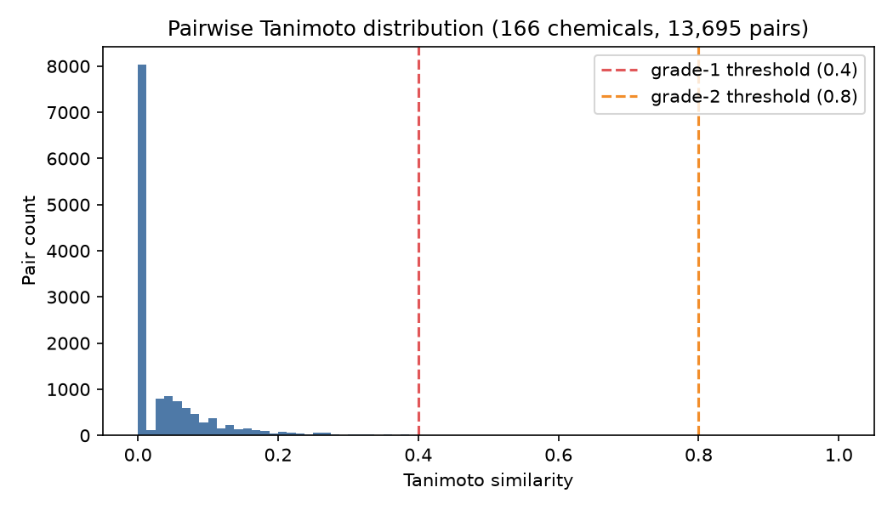
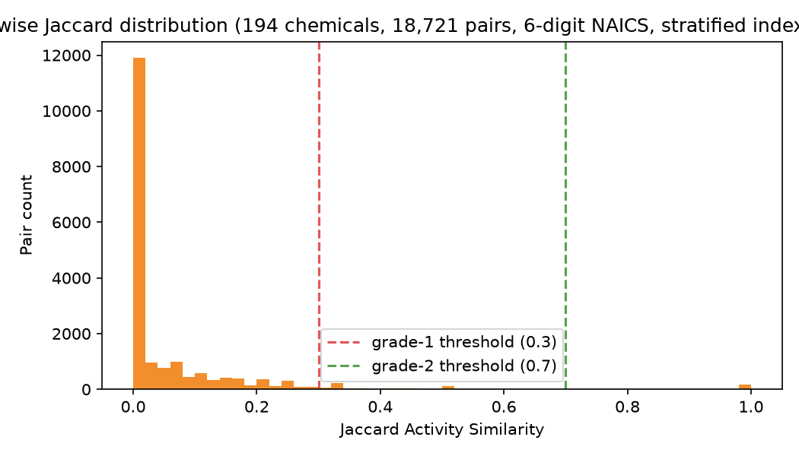
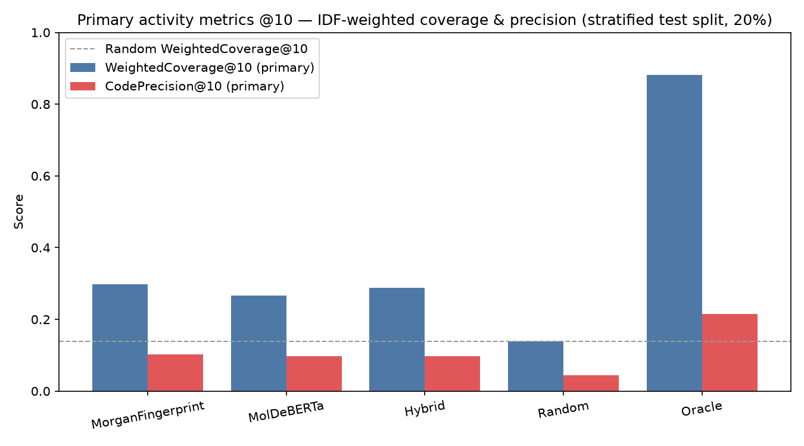
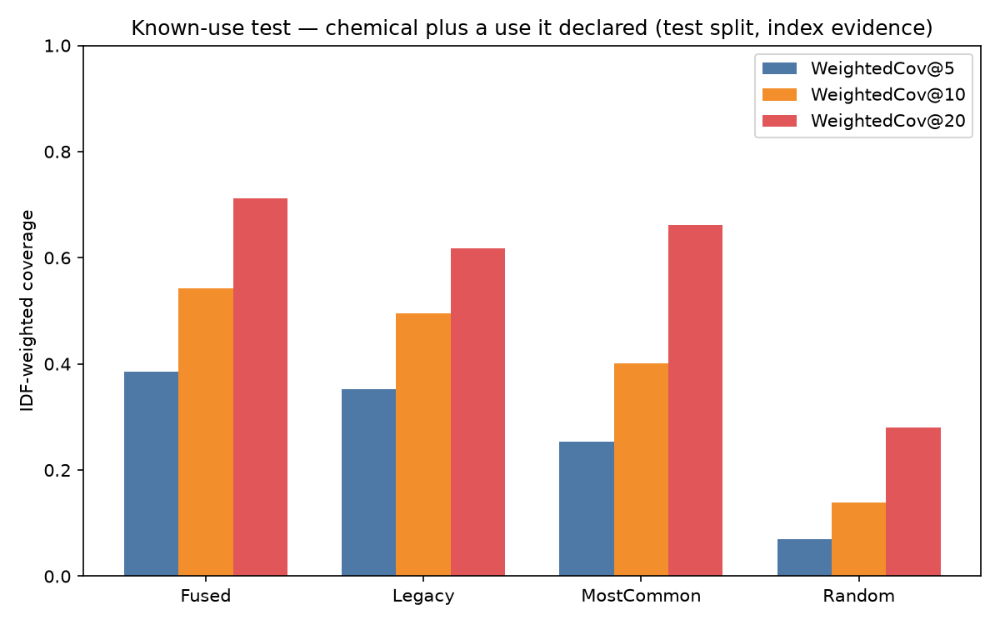
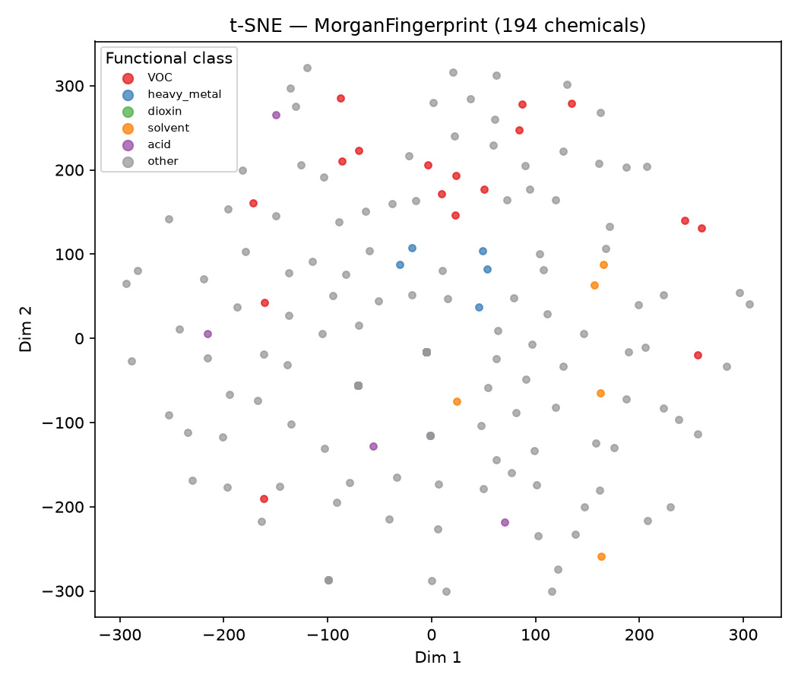
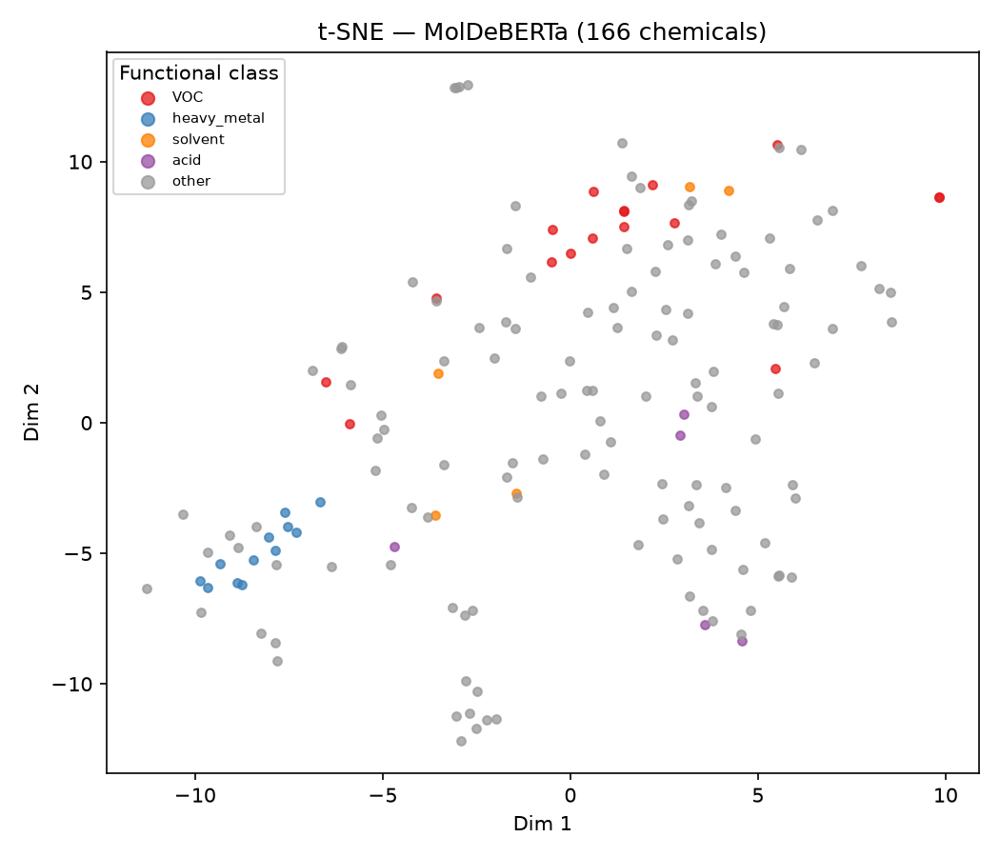
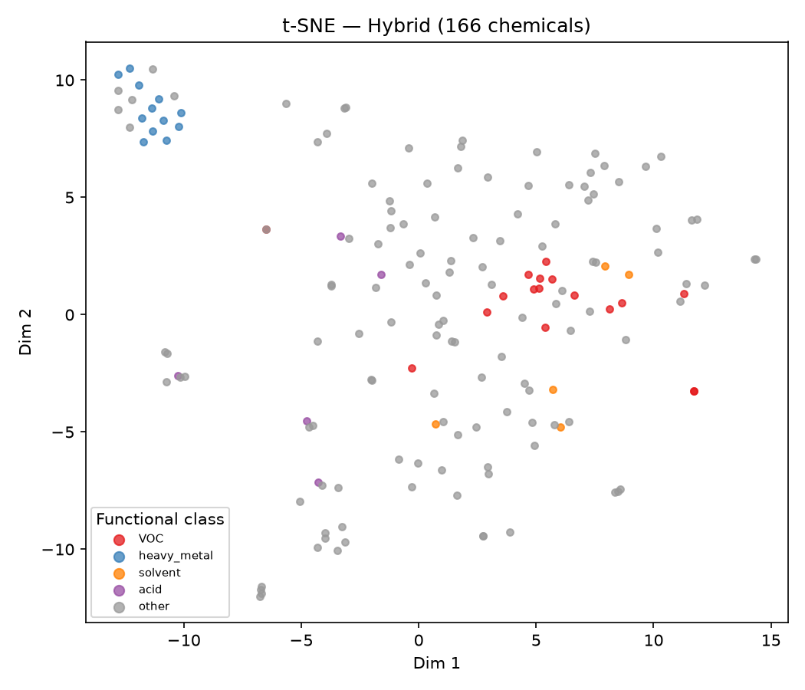
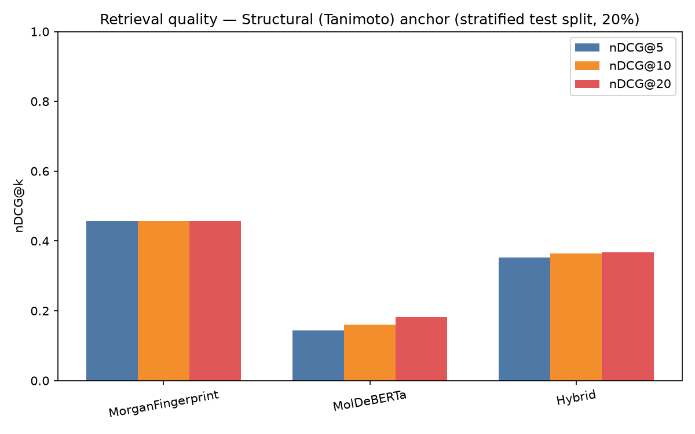
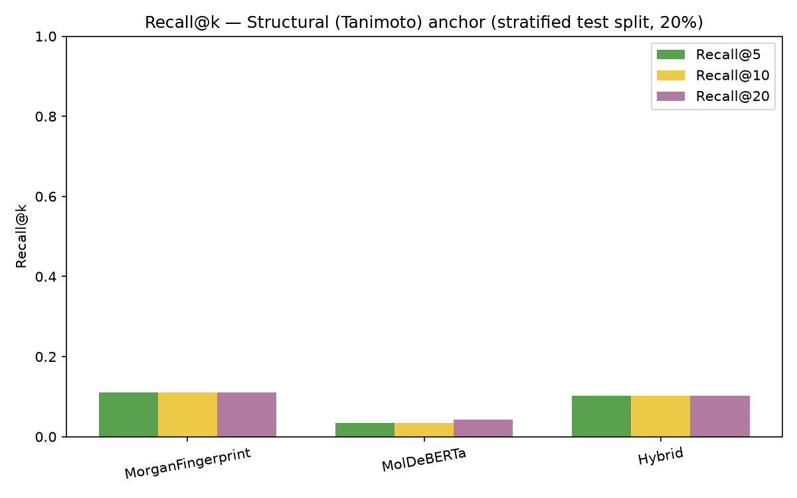

# Evaluation Results — TRI Chemical GraphRAG

Run date: 2026-11-04 16:29

---

## 1 · Anchor Statistics

### Structural Anchor (Tanimoto, independent of all embeddings)

| Metric | Value |
|--------|-------|
| Chemicals with valid SMILES | 166 |
| Unique pairwise comparisons | 13,695 |
| Grade-2 pairs (Tanimoto ≥ 0.8) | 95 |
| Grade-1 pairs (Tanimoto 0.4–0.8) | 56 |
| Grade-0 pairs (Tanimoto < 0.4) | 13,544 |

### Operational Anchor (Jaccard Activity Similarity, stratified index split)

Grades based on overlap of source reduction activity codes (Jaccard) and shared
(6-digit NAICS × activity code) combinations.

| Metric | Value |
|--------|-------|
| Chemicals with activity profiles | 194 |
| Unique pairwise comparisons | 18,721 |
| Grade-2 (Jaccard ≥ 0.7 AND NAICS co-occ ≥ 3) | 2 |
| Grade-1 (Jaccard ≥ 0.3 OR NAICS co-occ ≥ 1) | 1,444 |
| Grade-0 (no activity overlap) | 17,275 |

---

## 2 · Activity Coverage (PRIMARY — stratified test split, 20%)

This is a top-k **recommendation** metric: the nearest-neighbour chemicals are flattened into
a similarity-ranked list of distinct activity codes, and the top-k codes are scored against the
query chemical's actual test-split activities. **WeightedCoverage@k** (primary) is the
IDF-weighted fraction of the query's activities recovered by the top-k codes — rare, specific
codes count more than ubiquitous ones. **CodePrecision@10** (primary) is the fraction of the
top-k recommended codes that are actually relevant, penalizing indiscriminate breadth.
**Lift@10 vs Random** shows the absolute and multiplicative gain over the Random baseline; a
method only genuinely helps when Lift > 0.  **RawCov@10** is the unweighted union coverage,
retained as a diagnostic (expect Random to score high here — that is the artifact the weighted
metric corrects).  FamilyCov@10 uses the five TRI_SOURCE_REDUCTION_GROUPS families.
Oracle@k is the ceiling: the k index chemicals with maximum Jaccard overlap with the query's
test-split codes (uses ground truth — not achievable by any blind retrieval method).

| Embedding | WeightedCov@5 ↑ | @10 | @20 | Lift@10 vs Random | CodePrec@10 ↑ | RawCov@10 | FamilyCov@10 | n |
|-----------|----------------|-----|-----|-------------------|--------------|-----------|--------------|---|
| MorganFingerprint | 0.1327 | 0.2983 | 0.5332 | +0.159 (2.15×) | 0.1017 | 0.3060 | 0.7901 | 118 |
| MolDeBERTa | 0.1446 | 0.2661 | 0.4972 | +0.127 (1.91×) | 0.0966 | 0.2771 | 0.8555 | 118 |
| Hybrid | 0.1546 | 0.2885 | 0.5131 | +0.150 (2.08×) | 0.0975 | 0.2969 | 0.8674 | 118 |
| Random | 0.0680 | 0.1390 | 0.2817 | — | 0.0447 | 0.1390 | 0.7939 | 118 |
| Oracle | 0.8300 | 0.8817 | 0.9426 | — | 0.2153 | 0.8937 | 0.9802 | 118 |

---

## 2b · Shipped Recommender — End-to-End Path (stratified test split, 20%)

Scores the **production** recommendation path as deployed.  The query is the chemical alone
(no condition of use, no sector).  `Shipped (fused)` is the configured default
(`RETRIEVAL: fused`: reciprocal-rank fusion of the chemical, use, sector and prior channels over
reduction records, with the equal-weight variant F1); `Legacy` is the previous path
(`retrieve_multi`: vector ANN + graph traversal + cross-entity intersection), kept available
with `RETRIEVAL: legacy`.  Here k is the number of distinct top-ranked recommended activity
codes, and the same IDF-weighted coverage / code-precision metrics are applied.  Both read
**index-split reports only**: the query chemical's withheld test reports are hidden from the
graph.  Both share one record cap, fixed in advance: at most 5000 de-duplicated records
per query before distinct codes are taken, so that each can list at least 20 distinct codes
(k = 20) where its evidence allows (Legacy keeps its shipped limits of 5 neighbours and 50 reports
per chemical, which are retrieval limits and not the record cap).  Random draws k codes uniformly;
Oracle recommends the query's own highest-weight codes (ceiling).  MostCommon always recommends
the k activity codes reported by the most index-split chemicals (a popularity floor).

| Method | WeightedCov@5 ↑ | @10 | @20 | Lift@10 vs Random | CodePrec@10 ↑ | RawCov@10 | n |
|--------|----------------|-----|-----|-------------------|--------------|-----------|---|
| Shipped (fused) | 0.2660 | 0.4215 | 0.6056 | +0.292 (3.25×) | 0.1458 | 0.4410 | 118 |
| Legacy | 0.2655 | 0.3649 | 0.5744 | +0.235 (2.81×) | 0.1102 | 0.3714 | 118 |
| MostCommon | 0.2291 | 0.3807 | 0.6500 | +0.251 (2.94×) | 0.1407 | 0.4112 | 118 |
| Random | 0.0659 | 0.1296 | 0.2725 | — | 0.0435 | 0.1298 | 118 |
| Oracle | 0.9406 | 0.9826 | 0.9976 | — | 1.0000 | 0.9783 | 118 |

---

## 2c · Known-Use Test — Chemical Plus a Use It Declared (stratified test split, 20%)

Table 2b gives the recommender the chemical alone.  Here each test chemical is queried once per
distinct condition of use (Activity name) declared in its test-split reports: the query is its SMILES
plus that use, and the truth is the set of reduction codes on its test-split reports declaring that
use.  Evidence is index-split reports only, with the same record cap of 5000 de-duplicated
records.  `Fused` is the shipped default; `Legacy` applies the use as a hard filter on the
nearest-neighbour pool; MostCommon and Random are as above.  Queries are averaged within each chemical,
which is the unit of the paired Wilcoxon test (two-sided) of WeightedCov@10 against Fused.

| Method | WeightedCov@5 ↑ | @10 | @20 | Lift@10 vs Random | CodePrec@10 ↑ | RawCov@10 | Distinct codes listed | p vs Fused (WCov@10) | queries | chemicals |
|--------|---|---|---|---|---|---|---|---|---|---|
| Fused | 0.3858 | 0.5431 | 0.7116 | +0.404 (3.91×) | 0.0768 | 0.5516 | 72.0 | — | 457 | 106 |
| Legacy | 0.3523 | 0.4945 | 0.6175 | +0.356 (3.56×) | 0.0740 | 0.4994 | 18.5 | 0.013 | 457 | 106 |
| MostCommon | 0.2529 | 0.4017 | 0.6623 | +0.263 (2.89×) | 0.0614 | 0.4152 | — | 0.0016 | 457 | 106 |
| Random | 0.0700 | 0.1388 | 0.2802 | — | 0.0195 | 0.1387 | — | 3.6e-14 | 457 | 106 |

---

## 3 · NAICS Hierarchy Analysis — SectorCoverage@10

Sector-conditioned coverage: both query activities and retrieved activities restricted
to the same NAICS prefix at the given digit depth.
Broader prefixes (2-digit) match more sector contexts and typically yield higher coverage;
narrower prefixes (6-digit) isolate activity recommendations to the specific industry.

| Embedding | 2-digit (Sector) | 3-digit (Subsector) | 4-digit (Ind. Group) | 6-digit (National) |
|-----------|----------------------|----------------------|----------------------|----------------------|
| MorganFingerprint | 0.5519 | 0.3809 | 0.2285 | 0.1785 |
| MolDeBERTa | 0.4133 | 0.2256 | 0.1144 | 0.0706 |
| Hybrid | 0.5570 | 0.3962 | 0.2299 | 0.1805 |
| Random | 0.4762 | 0.2611 | 0.1103 | 0.0618 |

---

## 4 · Embedding Space Quality (intrinsic)

Spearman ρ is reported against structural (Tanimoto), operational code-level (Jaccard),
and operational family-level (Jaccard on activity families) distance matrices.

| Embedding | n | Silhouette ↑ | DB ↓ | ρ Tanimoto ↑ | p | ρ Jaccard (code) ↑ | p | ρ Jaccard (family) ↑ | p | Notes |
|-----------|---|-------------|------|-------------|----|--------------------|----|--------------------|----|-------|
| MorganFingerprint | 194 | -0.3704 | 3.9362 | 0.9982 | 0.0000 | -0.0918 | 0.0000 | 0.0422 | 0.0000 |  |
| MolDeBERTa | 166 | -0.1440 | 3.2188 | 0.2803 | 0.0000 | 0.0278 | 0.0000 | 0.0707 | 0.0000 |  |
| Hybrid | 166 | -0.0619 | 3.4105 | 0.3824 | 0.0000 | 0.0017 | 0.7787 | 0.0188 | 0.0018 |  |

**t-SNE projections** (colored by functional class — VOC, heavy metal, dioxin, solvent, acid, other):

| MorganFingerprint | MolDeBERTa | Hybrid |
|:---:|:---:|:---:|
|  |  |  |

---

## 5 · Retrieval Quality — Structural Anchor (Tanimoto, BASELINE — stratified test split 20%)

| Embedding | n queries | nDCG@5 | nDCG@10 | nDCG@20 | Recall@10 | MRR |
|-----------|-----------|--------|---------|---------|-----------|-----|
| MorganFingerprint | 118 | 0.4569 | 0.4569 | 0.4569 | 0.1102 | 0.1102 |
| MolDeBERTa | 118 | 0.1429 | 0.1602 | 0.1826 | 0.0339 | 0.0290 |
| Hybrid | 118 | 0.3533 | 0.3634 | 0.3677 | 0.1017 | 0.0960 |

### Wilcoxon signed-rank significance tests (nDCG@10, structural anchor)

| Comparison | k | Statistic | p-value | Significant |
|------------|---|-----------|---------|-------------|
| MorganFingerprint vs MolDeBERTa | 10 | 0.0000 | 0.0000 | Yes |
| MorganFingerprint vs Hybrid | 10 | 0.0000 | 0.0000 | Yes |
| MolDeBERTa vs Hybrid | 10 | 24.0000 | 0.0000 | Yes |

---

## 6 · Retrieval Quality — Operational Anchor (Jaccard, SECONDARY — stratified test split 20%)

| Embedding | n queries | nDCG@5 | nDCG@10 | nDCG@20 | Recall@10 | MRR |
|-----------|-----------|--------|---------|---------|-----------|-----|
| MorganFingerprint | 118 | 0.1789 | 0.1677 | 0.1690 | 0.0169 | 0.0169 |
| MolDeBERTa | 118 | 0.1367 | 0.1229 | 0.1236 | 0.0000 | 0.0000 |
| Hybrid | 118 | 0.2309 | 0.2058 | 0.1914 | 0.0169 | 0.0169 |

### Wilcoxon signed-rank significance tests (nDCG@10, operational anchor)

| Comparison | k | Statistic | p-value | Significant |
|------------|---|-----------|---------|-------------|
| MorganFingerprint vs MolDeBERTa | 10 | 1404.0000 | 0.0893 | No |
| MorganFingerprint vs Hybrid | 10 | 980.0000 | 0.0052 | Yes |
| MolDeBERTa vs Hybrid | 10 | 743.0000 | 0.0000 | Yes |

---

## 7 · End-to-End RAG Quality (RAGAS)

| Condition | Faithfulness ↑ | Ctx. Precision ↑ | Ctx. Recall ↑ | n scored | attempted | failed |
|-----------|---------------|-----------------|---------------|----------|-----------|--------|
| MorganFingerprint | 0.6882 | 0.3125 | 0.4875 | 8 | 8 | 0 |
| MolDeBERTa | 0.5986 | 0.1250 | 0.1500 | 8 | 8 | 0 |
| Hybrid | 0.4998 | 0.2500 | 0.4000 | 8 | 8 | 0 |
| flat | 0.4938 | 0.0000 | 0.0000 | 8 | 8 | 0 |

**How to read this table.** Every condition runs the full RAG pipeline end-to-end and is scored by an LLM judge. *Faithfulness* asks whether the generated answer is grounded in the retrieved context (anti-hallucination); *context precision* whether the retrieved context is relevant and well-ranked; *context recall* whether retrieval surfaced everything the reference answer needs. The **flat** row is the ablation baseline — vector retrieval with **no graph traversal** — so the gap between each GraphRAG condition and `flat` is the graph's contribution. `flat` scoring 0 precision / 0 recall while every GraphRAG condition is positive on both is the intended "graph context helps" signal; structural (Morgan) and Hybrid retrieval beat pure-semantic MolDeBERTa, consistent with §2–§6 where MolDeBERTa is the weakest retriever. Because scores are end-to-end and **judge-dependent**, absolute values are not comparable across judge models (a stronger judge lowers precision roughly uniformly) and n is small — read the table for *relative ordering*, not absolute magnitudes.

**Strongest embedding & decision implications.** Across the operationally-relevant metrics — sector coverage (§3, all NAICS levels), operational/activity retrieval (§6), and cluster quality (§4) — **Hybrid (Morgan ‖ MolDeBERTa) is strongest**; **Morgan** leads only on the structural anchor (§5, which is definitionally Tanimoto-based) and on §7 precision, while **MolDeBERTa** alone is the weakest retriever. This matters because the two error types are not symmetric. *Context precision* governs **false positives** — recommending a source-reduction activity that is not actually applicable, costing wasted engineering assessment and capital, but bounded and caught during expert review. *Context recall / coverage* governs **false negatives** — missing a reduction that would have worked, i.e. a forgone prevention opportunity and continued, avoidable emissions; environmentally that error is costlier and effectively irreversible. So for the research question *"is there a useful source reduction for this chemical?"* — a screening / discovery task with an expert validating candidates downstream — the priority is to **minimize false negatives**: optimize **recall / coverage**, where **Hybrid** is best (best §7 recall and §3/§6 coverage). Prefer **Morgan** only when the goal is high-precision structural-analogue search and false positives are the costlier error (e.g. fully automated recommendation with no human in the loop). See `DECISION_FRAMEWORK.md` for the full hypothesis-testing treatment (Type I/II errors, precision/recall, and the faithfulness hallucination guardrail).

RAGAS judge: **ollama_cloud / gpt-oss:120b-cloud** (answer generator: llama3.1). Faithfulness and context-recall require a GPT-4-class judge — local 7-14B judges emit the wrong schema (→ NaN) and qwen2.5:32b is too slow; a hosted cloud model recovers all three metrics.

---

## 8 · Notes

- All metrics use a stratified random split (80% index, 20% test, seed=42) across all report years.
- Structural Tanimoto thresholds (0.4 / 0.8) and k values (5, 10, 20) are pre-registered and unchanged.
- Operational anchor uses Jaccard ≥ 0.7 AND NAICS co-occ ≥ 3 for grade-2 (pre-registered).
- NAICS grouping: 6-digit (National Industry).
- RAGAS judge: ollama_cloud / gpt-oss:120b-cloud (provider / model; answer generator: llama3.1).
