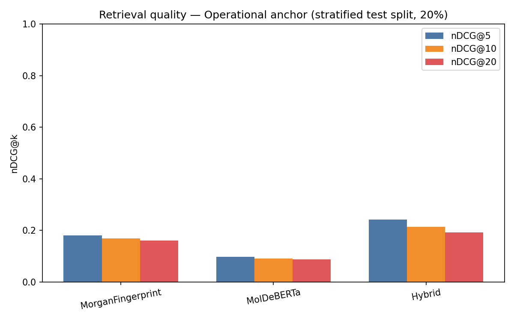
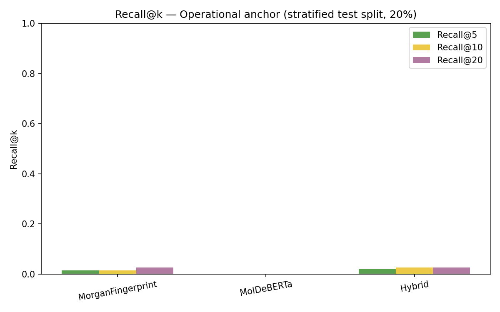

# Evaluation Results — TRI Chemical GraphRAG

Run date: 2026-06-15 20:43

---

## 1 · Anchor Statistics

### Structural Anchor (Tanimoto, independent of all embeddings)

| Metric | Value |
|--------|-------|
| Chemicals with valid SMILES | 474 |
| Unique pairwise comparisons | 112,101 |
| Grade-2 pairs (Tanimoto ≥ 0.8) | 275 |
| Grade-1 pairs (Tanimoto 0.4–0.8) | 451 |
| Grade-0 pairs (Tanimoto < 0.4) | 111,375 |

### Operational Anchor (Jaccard Activity Similarity, stratified index split)

Grades based on overlap of source reduction activity codes (Jaccard) and shared
(6-digit NAICS × activity code) combinations.

| Metric | Value |
|--------|-------|
| Chemicals with activity profiles | 225 |
| Unique pairwise comparisons | 25,200 |
| Grade-2 (Jaccard ≥ 0.7 AND NAICS co-occ ≥ 3) | 5 |
| Grade-1 (Jaccard ≥ 0.3 OR NAICS co-occ ≥ 1) | 3,627 |
| Grade-0 (no activity overlap) | 21,568 |

---

## 2 · Activity Coverage (PRIMARY — stratified test split, 20%)

This is a top-k **recommendation** metric: the nearest-neighbour chemicals are flattened into
a similarity-ranked list of distinct activity codes, and the top-k codes are scored against the
query chemical's actual test-split activities. **WeightedCoverage@k** (primary) is the
IDF-weighted fraction of the query's activities recovered by the top-k codes — rare, specific
codes count more than ubiquitous ones. **CodePrecision@10** (primary) is the fraction of the
top-k recommended codes that are actually relevant, penalizing indiscriminate breadth.
**Lift@10 vs Random** shows the absolute and multiplicative gain over the Random baseline; a
method only genuinely helps when Lift > 0.  **RawCov@10** is the unweighted union coverage,
retained as a diagnostic (expect Random to score high here — that is the artifact the weighted
metric corrects).  FamilyCov@10 uses the five TRI_SOURCE_REDUCTION_GROUPS families.
Oracle@k is the ceiling: the k index chemicals with maximum Jaccard overlap with the query's
test-split codes (uses ground truth — not achievable by any blind retrieval method).

| Embedding | WeightedCov@5 ↑ | @10 | @20 | Lift@10 vs Random | CodePrec@10 ↑ | RawCov@10 | FamilyCov@10 | n |
|-----------|----------------|-----|-----|-------------------|--------------|-----------|--------------|---|
| MorganFingerprint | 0.1889 | 0.3612 | 0.6162 | +0.222 (2.60×) | 0.1496 | 0.3787 | 0.7851 | 135 |
| MolDeBERTa | 0.1912 | 0.3867 | 0.6243 | +0.248 (2.78×) | 0.1674 | 0.4101 | 0.8302 | 135 |
| Hybrid | 0.2116 | 0.3466 | 0.6438 | +0.208 (2.49×) | 0.1511 | 0.3646 | 0.8157 | 135 |
| Random | 0.0696 | 0.1391 | 0.2747 | — | 0.0623 | 0.1387 | 0.6565 | 135 |
| Oracle | 0.7334 | 0.8274 | 0.9093 | — | 0.2652 | 0.8476 | 0.9258 | 135 |

---

## 2b · Shipped Recommender — End-to-End Graph Path (stratified test split, 20%)

Scores the **production** recommendation path exactly as deployed: `retrieve_multi`
(vector ANN + graph traversal + cross-entity intersection) → ranked source-reduction
records.  Here k is the number of distinct top-ranked recommended activity codes, and
the same IDF-weighted coverage / code-precision metrics are applied.  This is the table
that reflects what an end user actually receives, in contrast to the pure-vector intrinsic
metrics above.  Random draws k codes uniformly; Oracle recommends the query's own
highest-weight codes (ceiling).

| Method | WeightedCov@5 ↑ | @10 | @20 | Lift@10 vs Random | CodePrec@10 ↑ | RawCov@10 | n |
|--------|----------------|-----|-----|-------------------|--------------|-----------|---|
| ShippedRecommender | 0.6387 | 0.7805 | 0.8554 | +0.641 (5.58×) | 0.3106 | 0.7876 | 135 |
| Random | 0.0688 | 0.1398 | 0.2750 | — | 0.0625 | 0.1396 | 135 |
| Oracle | 0.9023 | 0.9576 | 0.9925 | — | 1.0000 | 0.9480 | 135 |

---

## 3 · NAICS Hierarchy Analysis — SectorCoverage@10

Sector-conditioned coverage: both query activities and retrieved activities restricted
to the same NAICS prefix at the given digit depth.
Broader prefixes (2-digit) match more sector contexts and typically yield higher coverage;
narrower prefixes (6-digit) isolate activity recommendations to the specific industry.

| Embedding | 2-digit (Sector) | 3-digit (Subsector) | 4-digit (Ind. Group) | 6-digit (National) |
|-----------|----------------------|----------------------|----------------------|----------------------|
| MorganFingerprint | 0.5319 | 0.4092 | 0.2699 | 0.1925 |
| MolDeBERTa | 0.4095 | 0.2564 | 0.1352 | 0.1004 |
| Hybrid | 0.5411 | 0.4383 | 0.3370 | 0.2598 |
| Random | 0.6013 | 0.3748 | 0.1936 | 0.1155 |

---

## 4 · Embedding Space Quality (intrinsic)

Spearman ρ is reported against structural (Tanimoto), operational code-level (Jaccard),
and operational family-level (Jaccard on activity families) distance matrices.

| Embedding | n | Silhouette ↑ | DB ↓ | ρ Tanimoto ↑ | p | ρ Jaccard (code) ↑ | p | ρ Jaccard (family) ↑ | p | Notes |
|-----------|---|-------------|------|-------------|----|--------------------|----|--------------------|----|-------|
| MorganFingerprint | 529 | -0.2592 | 4.6829 | 0.9952 | 0.0000 | -0.1343 | 0.0000 | -0.1181 | 0.0000 |  |
| MolDeBERTa | 474 | -0.2258 | 4.0957 | 0.2717 | 0.0000 | 0.0700 | 0.0000 | 0.0786 | 0.0000 |  |
| Hybrid | 474 | -0.0907 | 3.7662 | 0.3579 | 0.0000 | 0.0776 | 0.0000 | 0.0825 | 0.0000 |  |

**t-SNE projections** (colored by functional class — VOC, heavy metal, dioxin, solvent, acid, other):

| MorganFingerprint | MolDeBERTa | Hybrid |
|:---:|:---:|:---:|
|  |  |  |

---

## 5 · Retrieval Quality — Structural Anchor (Tanimoto, BASELINE — stratified test split 20%)

| Embedding | n queries | nDCG@5 | nDCG@10 | nDCG@20 | Recall@10 | MRR |
|-----------|-----------|--------|---------|---------|-----------|-----|
| MorganFingerprint | 394 | 0.6124 | 0.6124 | 0.6124 | 0.1066 | 0.1066 |
| MolDeBERTa | 394 | 0.1098 | 0.1214 | 0.1367 | 0.0228 | 0.0174 |
| Hybrid | 394 | 0.4655 | 0.4784 | 0.4927 | 0.1041 | 0.0988 |

### Wilcoxon signed-rank significance tests (nDCG@10, structural anchor)

| Comparison | k | Statistic | p-value | Significant |
|------------|---|-----------|---------|-------------|
| MorganFingerprint vs MolDeBERTa | 10 | 2.0000 | 0.0000 | Yes |
| MorganFingerprint vs Hybrid | 10 | 34.0000 | 0.0000 | Yes |
| MolDeBERTa vs Hybrid | 10 | 126.0000 | 0.0000 | Yes |

---

## 6 · Retrieval Quality — Operational Anchor (Jaccard, SECONDARY — stratified test split 20%)

| Embedding | n queries | nDCG@5 | nDCG@10 | nDCG@20 | Recall@10 | MRR |
|-----------|-----------|--------|---------|---------|-----------|-----|
| MorganFingerprint | 195 | 0.1810 | 0.1698 | 0.1616 | 0.0154 | 0.0119 |
| MolDeBERTa | 195 | 0.0974 | 0.0919 | 0.0871 | 0.0000 | 0.0000 |
| Hybrid | 195 | 0.2414 | 0.2131 | 0.1920 | 0.0256 | 0.0212 |

### Wilcoxon signed-rank significance tests (nDCG@10, operational anchor)

| Comparison | k | Statistic | p-value | Significant |
|------------|---|-----------|---------|-------------|
| MorganFingerprint vs MolDeBERTa | 10 | 1704.5000 | 0.0000 | Yes |
| MorganFingerprint vs Hybrid | 10 | 2789.0000 | 0.0010 | Yes |
| MolDeBERTa vs Hybrid | 10 | 961.5000 | 0.0000 | Yes |

---

## 7 · End-to-End RAG Quality (RAGAS)

| Condition | Faithfulness ↑ | Ctx. Precision ↑ | Ctx. Recall ↑ | n scored | attempted | failed |
|-----------|---------------|-----------------|---------------|----------|-----------|--------|
| MorganFingerprint | — | 0.5667 | — | 3 | 4 | 1 |
| MolDeBERTa | 0.7500 | 0.3347 | 0.0833 | 4 | 4 | 0 |
| Hybrid | 1.0000 | 0.4125 | 0.0000 | 4 | 4 | 0 |
| flat | 0.7917 | 0.0000 | 0.0000 | 4 | 4 | 0 |

---

## 8 · Notes

- All metrics use a stratified random split (80% index, 20% test, seed=42) across all report years.
- Structural Tanimoto thresholds (0.4 / 0.8) and k values (5, 10, 20) are pre-registered and unchanged.
- Operational anchor uses Jaccard ≥ 0.7 AND NAICS co-occ ≥ 3 for grade-2 (pre-registered).
- NAICS grouping: 6-digit (National Industry).
- RAGAS judge: granite3.3:8b via Ollama (answer generator: llama3.1).
